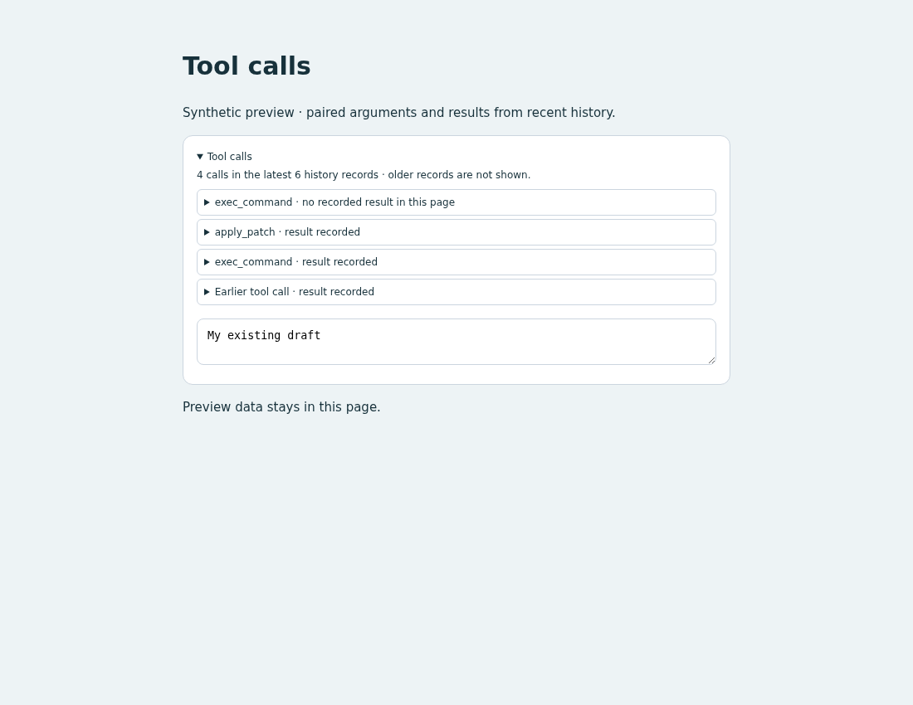

# Tool calls

## Behavior

Add a collapsible tool-history panel above the composer. Opening a call reveals
its ID, arguments/input and recorded output. Function and custom-tool results
are paired by `call_id`. For example, an `exec_command` row shows its submitted
command and the later result together.

The newest 200 history records are queried every two seconds after the previous
request completes. Rows show newest calls first. A call without a result in
that page says so; it is not labeled as currently running. A result whose call
is outside the page is still displayed as an earlier tool call.

## Source

- [custom.js](source/custom.js): recent-history polling, call/result pairing,
  expandable rendering and session cleanup.
- [custom.css](source/custom.css): scoped panel and bounded output scrolling.
- [preview.html](preview.html): standalone synthetic preview.
- [fixture.mjs](source/fixture.mjs) and [verify.mjs](source/verify.mjs): synthetic
  function/custom calls, boundary cases and browser checks.

## Integration

Read the installed `WORKSPACE_API.md`. The example uses
`GET api/sessions/{id}/history?limit=200` through `host.request`.
It consumes `response_item` records of type `function_call`, `custom_tool_call`,
`function_call_output` and `custom_tool_call_output`.
The built-in host supplies session selection and `.composer` is the insertion
location. All rendered tool data is assigned as text.

Adapt the JS into the user's existing `custom.js`, preserving a single
`mount(host)` export, and include the scoped CSS. Preserve unrelated source
and combine repeated session/request logic when composing the final frontend.
The preview and verification files are not runtime dependencies.

The returned cleanup removes listeners, requests, polling and UI. Use it when
removing this panel. Page-cache restoration restarts loading. To undo, remove
this setup and styles or restore the pre-edit backup. Refresh applies edits.

From the repository root:

```bash
python3 -m http.server 8765 --bind 127.0.0.1 --directory packages/pycodex-ws/workspace_server/examples/tool-calls
```

Open `http://127.0.0.1:8765/preview.html?verify` for PASS/FAIL checks with synthetic
data; use the page without `?verify` to inspect the panel. Stop with Ctrl-C.

## Validation

Chromium checks passed:

| Scenario | Observed result |
| --- | --- |
| Function/custom calls and outputs | Paired by ID into four rows |
| Output with its call outside the page | Output retained as an earlier call |
| Call without a recorded result | Explicit incomplete-page label |
| Structured output containing HTML-like text | Shown literally; no markup created |
| Session switch with a late response; request error and recovery | No cross-session overwrite; error visible then cleared |
| Page hide/cache restore, disposal and remount | Polling and listeners cleaned up/restored |
| Desktop, 390px mobile and page refresh | No horizontal overflow; draft retained |

The rerunnable browser checks live in `preview.html?verify`.
[Desktop](preview.png) and [mobile](preview-mobile.png) screenshots use fixtures.
No real tools were executed as part of this template's browser verification.

## Preview



## Limitations

This is recent recorded history, not live tool-event streaming or a full archive.
Calls/results outside the page may be missing; the panel reports truncation.
Every refresh starts from the newest page, so fork/compaction cannot leave a
stored history cursor invalid. It does not paginate older data. Recorded tool
outputs do not retain the Runtime's `is_error` flag, so the panel reports
"result recorded" instead of asserting success. Provider-native tool types
outside the four supported record types are not displayed.
