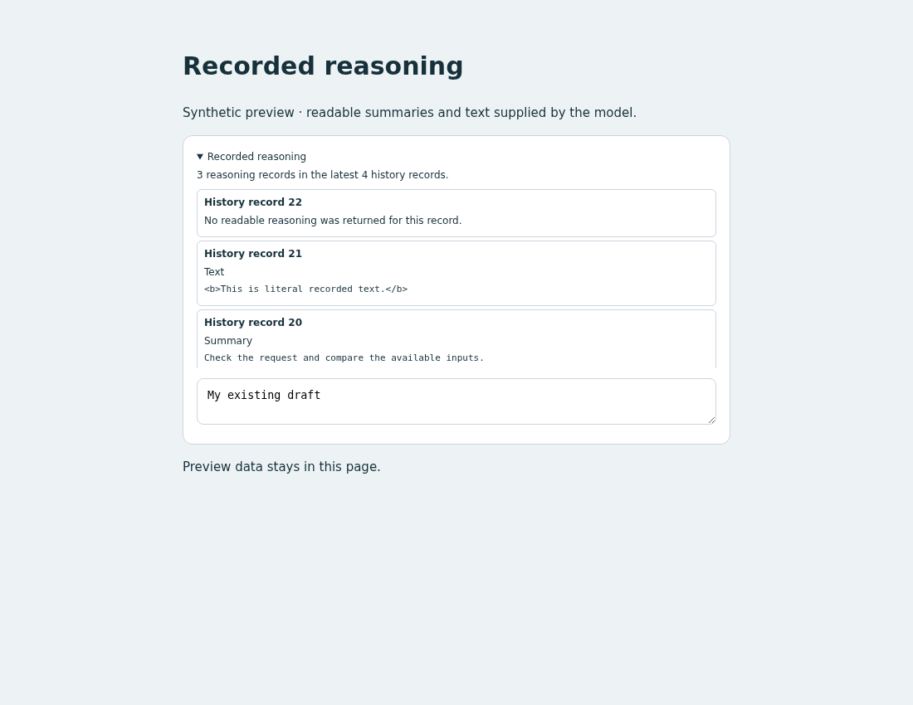

# Recorded reasoning

## Behavior

Add a collapsible panel showing readable reasoning returned by the model and
recorded in the conversation. A reasoning record can contain summary text,
reasoning text, both, or neither. Records without readable content get an
explicit unavailable message.

The panel reads the newest 200 history records every two seconds after the
previous request finishes. It renders newest reasoning records first.
Assistant message text and the display snapshot's `thinking` field are not used.

## Source

- [custom.js](source/custom.js): record filtering, rendering and session lifecycle.
- [custom.css](source/custom.css): scoped panel and bounded scrolling.
- [preview.html](preview.html): standalone synthetic preview.
- [fixture.mjs](source/fixture.mjs) and [verify.mjs](source/verify.mjs): readable,
  opaque-only and assistant-message fixtures plus browser checks.

## Integration

Read the installed `WORKSPACE_API.md`. The example queries
`GET api/sessions/{id}/history?limit=200` with `host.request` and uses the host's
active-session/subscription methods. It reads only `response_item` payloads
whose type is `reasoning`, extracting `summary_text` parts from `summary` and
`reasoning_text` parts from `content`. Nullable/missing content is valid.
Opaque encrypted content is never copied into the panel or its row cache.

Adapt the JS into the user's frontend, merging with the existing `mount(host)`
if present, and add its scoped CSS. The built-in `.composer` is the insertion
location. Share repeated session/request logic in the final source when useful.
Only `custom.js` and `custom.css` are runtime inputs.

Keep the returned cleanup if the panel can be removed. It stops requests,
timers and listeners. Page-cache restoration reloads the selected conversation.
To undo, remove the adapted setup/styles or restore the pre-edit backup;
refresh to apply the frontend.

From the repository root:

```bash
python3 -m http.server 8765 --bind 127.0.0.1 --directory packages/pycodex-ws/workspace_server/optinal_features/reasoning-display
```

Open `http://127.0.0.1:8765/preview.html?verify` for PASS/FAIL browser checks with
synthetic records. Stop the local server with Ctrl-C.

## Validation

Chromium checks passed:

| Scenario | Observed result |
| --- | --- |
| Readable summary and reasoning-text records | Both displayed in separate labeled sections |
| Opaque-only record | Unavailable message; opaque fixture bytes absent from DOM |
| Assistant message and HTML-like reasoning text | Assistant text excluded; reasoning text escaped by text rendering |
| Late response after switching, request failure and recovery | Current session preserved; error visible then cleared |
| Page hide/cache restore, disposal and remount | Requests/timers/listeners stopped or restored |
| Desktop, 390px mobile and refresh | No horizontal overflow; draft preserved |

Run `preview.html?verify` to repeat these checks.
[Desktop](preview.png) and [mobile](preview-mobile.png) screenshots use synthetic
data. Provider reasoning availability was not tested with a live model.

## Preview



## Limitations

The current API supplies no dedicated live reasoning-delta event. This example
does not decrypt, infer or reconstruct hidden reasoning. Some models return no
readable reasoning. Older records beyond the newest page are not loaded, and
unrecorded sessions expose only active in-memory history. A fresh newest-page
query each time avoids retaining cursors across fork/compaction.
