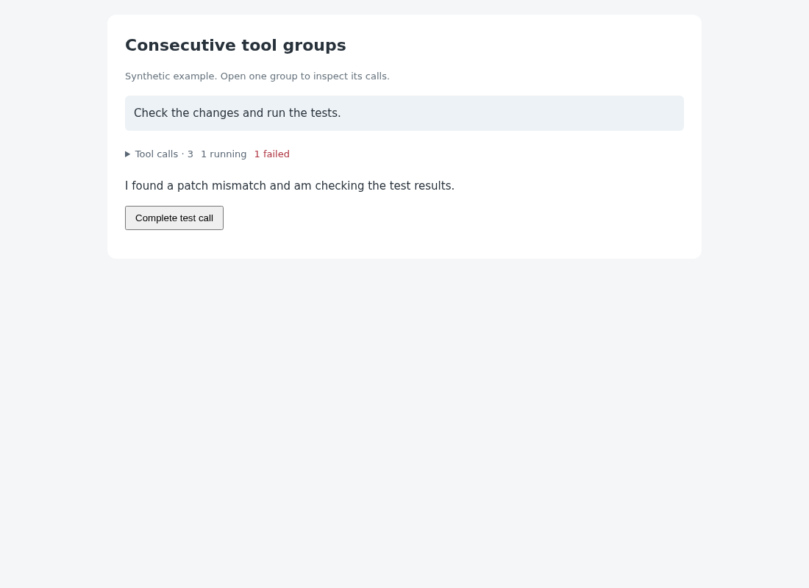

# Consecutive tool groups

## Behavior

Replace a run of individual tool rows with one initially collapsed
`Tool calls · 3 · 1 running · 1 failed` row. Opening the group reveals the calls;
each call expands to show its recorded input and output.
Tool errors remain counted while the group is closed.

Updates retain existing DOM nodes and expanded rows. Group and call expansion
are stored in browser `sessionStorage`, scoped to the workspace page, session
and group identity. Refresh preserves expansion in the same browser tab.
Empty groups occupy no space. Input/output text is escaped and long output
scrolls within a 280px height limit.

## Source

- [tool-groups.js](source/tool-groups.js): independent group renderer, counts,
  incremental reconciliation, expansion storage and cleanup.
- [tool-groups.css](source/tool-groups.css): scoped group and call styles.
- [fixture.mjs](source/fixture.mjs): synthetic running, completed and failed calls.
- [verify.mjs](source/verify.mjs): rerunnable browser behavior checks.
- [preview.html](preview.html): a conversation example with a live completion button.

## Integration

This is focused rendering source, not a polling panel or an automatically
registered plugin. It can replace individual tool rows in an existing
conversation renderer. It does not require a separate tool-details feature
or new backend endpoint. Read the installed `WORKSPACE_API.md` when adapting
your existing tool-data source.

Copy the JS/CSS into the user's frontend directory and include the stylesheet.
In the conversation renderer, create one controller for each run of tool calls,
using the same container and identifiers on subsequent updates:

```js
import {createToolGroup} from "./tool-groups.js";

const group = createToolGroup(toolRowContainer, {
  sessionId: activeSessionId,
  groupId: turnId,
});
group.update([
  {call_id: "call-1", name: "exec_command", status: "running",
    arguments: {cmd: "python -m pytest"}},
]);
// On a result, replace the record in the supplied array and call update again.
// When removing its turn, switching session, or unmounting the frontend:
group.dispose();
```

The caller supplies chronological records with unique `call_id`, `name`,
optional `arguments`/freeform `input`, `output`, and `status`.
`running` and `error` must come from observed execution events; do not infer
them from missing history-page results. A recorded output without an explicit
execution status is labeled `result recorded`, without asserting success.
The existing workspace `tool_started`/`tool_completed` events provide live
calls and errors. The history API provides recorded calls/results paired by
`call_id`; its pagination and truncation rules still apply.

The caller owns grouping boundaries: one group per conversation turn matches
the example, while frontends that interleave commentary should start a new group
at each non-tool message. Do not combine calls from separate turns or sessions.
Keep existing request cancellation, replay handling and session guards in the
data adapter, and dispose removed controllers. The renderer starts no requests,
timers, observers or model work. No tool input or output is stored in browser
storage.

To undo, dispose the controllers and restore the previous row renderer/styles.
From the repository root, reproduce the example with:

```bash
python3 -m http.server 8765 --bind 127.0.0.1 --directory packages/pycodex-ws/workspace_server/optional_features/consecutive-tool-groups
```

Open `http://127.0.0.1:8765/preview.html?verify` for browser checks, or omit
`?verify` to inspect and interact with the example. Stop the server with Ctrl-C.
The renderer has no external library dependencies.

## Validation

The preview's `?verify` mode checks counts, initial collapse, joining running
calls, completion updates, retained call nodes, bounded escaped output,
remount/expansion restoration, session isolation, removal and disposal.
Browser validation additionally covers keyboard activation, 390px touch layout,
actual page refresh (including immediate navigation after toggling) and
unavailable storage. These scenarios passed in Chromium with no page errors.

These checks use synthetic calls. No real model request is executed, and this
focused renderer does not verify the caller's HTTP/WebSocket adapter. Requests,
reconnect replay and history pagination remain that adapter's responsibility.

## Preview

[Interactive conversation preview](preview.html). The initial view contains one
collapsed group between a user message and an assistant reply, with visible
running and failure counts.



[Expanded mobile screenshot](preview-mobile.png).

## Limitations

This source needs an existing conversation renderer to supply tool records and
retain controllers. Installing it alone does not change the built-in page.
It does not fetch older calls, infer running state from incomplete history,
truncate tool contents, or change execution/retry behavior.
The supplied records should follow the frontend's existing retention limit.
Expansion persists only within the same browser tab and stable session/group
identities; disabled/full storage retains state only in the current DOM.
