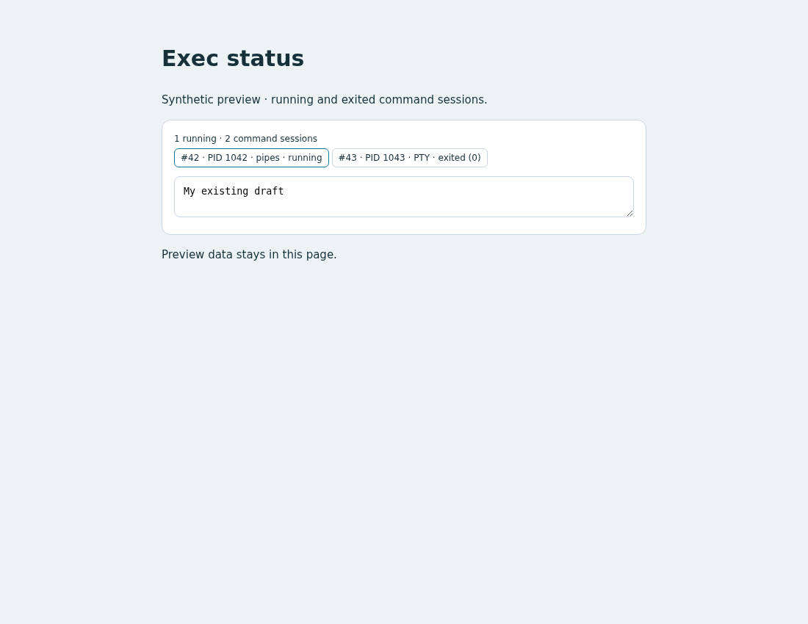

# Exec status

## Behavior

When a command remains in the exec manager, show its session ID, PID, PTY/pipes
mode and running/exited status above the draft. For example, an entry changes
from `running` to `exited (0)` when execution finishes. Released entries disappear.

The count and rows refresh every two seconds after the previous request finishes.
Changing the selected conversation clears the old rows immediately.

## Source

- [custom.js](source/custom.js): session-scoped inventory polling, rendering and cleanup.
- [custom.css](source/custom.css): compact wrapping status chips, scoped to this example.
- [preview.html](preview.html): standalone synthetic preview.
- [fixture.mjs](source/fixture.mjs) and [verify.mjs](source/verify.mjs): preview data
  and browser checks; these are not needed in a user's customized interface.

## Integration

Read the installed `WORKSPACE_API.md`. This example uses
`GET api/sessions/{id}/background-work` through `host.request`, plus
`getActiveSessionId()` and `onSessionChanged()`. It filters `kind === "exec"`.
The built-in page supplies `.composer` as the insertion location.

Adapt `custom.js` into the user's existing frontend and copy the scoped CSS.
If `custom.js` already exports `mount(host)`, merge this setup into that function;
retain one host entry point. When combining features, share repeated session
subscription/request logic in the resulting source as appropriate.
Keep existing draft behavior and unrelated customizations.

The returned cleanup function removes the panel, session listener and polling.
Call it if the frontend removes this UI. `pagehide` stops polling; restoration
from the browser's page cache resumes it. Refresh applies edits. To undo, remove
this setup and CSS or restore the pre-edit backup outside the served directory.

From the repository root, run the preview with:

```bash
python3 -m http.server 8765 --bind 127.0.0.1 --directory packages/pycodex-ws/workspace_server/optional_features/exec-status
```

Open `http://127.0.0.1:8765/preview.html?verify`. It reports PASS or FAIL using
synthetic API data, without invoking a model. Stop the server with Ctrl-C.

## Validation

Chromium checks passed for the supplied preview:

| Scenario | Observed result |
| --- | --- |
| Running, exited and clock records | Two exec entries; clock excluded; exit code and PID displayed |
| Initially empty selection, then running work | Empty state followed by the inventory |
| Switch with a late old response | Old request aborted; late data did not replace current rows |
| Failed request followed by successful polling | Error visible, then current rows restored |
| Page hide, cached-page restoration, disposal and remount | Polling paused/resumed; subscriptions and UI cleaned up |
| Desktop, 390px mobile and refresh | No horizontal overflow; composer draft preserved |

The checks are in `preview.html?verify`; [desktop](preview.png) and
[mobile](preview-mobile.png) screenshots use synthetic records.
Live process execution was not performed for this frontend template; its
network adapter follows the existing resource API contract.

## Preview



## Limitations

This is the selected root Agent's retained inventory, not a process archive.
Very short commands may finish and be released between polls. Arguments,
environment and command output are not supplied by this endpoint. There are
no process-control actions. Full HTML replacements must supply an insertion
location and initialize the adapted code themselves.
