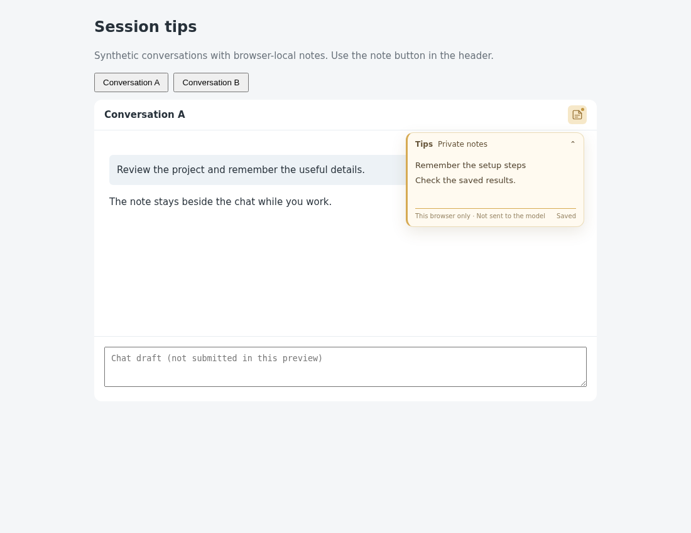

# Session tips

## Behavior

A note button in the conversation header opens a small warm-colored card.
For example, keep a setup reminder beside conversation A, switch to B to write
a separate reminder, then return to A without losing its note.

The card starts collapsed. Its open/closed preference is shared across sessions
in the workspace, while note text stays separate for each session.
Clicking the chat, typing a message, and navigating sessions keep the card open.
Close it explicitly with the note button, the card header, or Escape while
the note is focused. A dot and first-line tooltip indicate a nonempty note.
The card overlays the chat corner without changing the chat's geometry.

Text saves synchronously to this browser's `localStorage`. It is never inserted
into the composer, submitted to the model, or added to conversation history.
Recorded sessions use the rollout path as a stable identity across server
restarts. A note written before the first rollout migrates when that path
becomes available. Storage failures show an unsaved status and retain edits
in page memory.

## Source

- [session-tips.js](source/session-tips.js): standalone UI, session selection,
  note storage, migration, shared visibility and cleanup.
- [custom.js](source/custom.js): optional `mount(host)` adapter for the built-in
  workspace, with read-only session polling and lifecycle handling.
- [custom.css](source/custom.css): note button, compact card and mobile styles.
- [fixture.mjs](source/fixture.mjs): two synthetic sessions and a fake host.
- [verify.mjs](source/verify.mjs): rerunnable controller checks.
- [preview.html](preview.html): interactive two-conversation example.

## Integration

Read the installed `WORKSPACE_API.md` and inspect existing customizations first.
Copy `session-tips.js` alongside the user's `custom.js`; adapt the supplied
`mount(host)` into the existing mount function, and include `custom.css`.
Preserve unrelated source and keep a single mount entry point.
The adapter expects the built-in `.chat` container to be positioned relatively,
with a `.tabbar` inside it. It inserts its own note button and card.
There are no external runtime dependencies.

The adapter reads `GET api/session?session_id=...` through `host.request` every
two seconds after the previous request finishes. It consumes only
`snapshot.rollout_path` to follow restart, resume and fork identity changes.
No request contains note text. Requests are aborted on session changes and
page hide; late responses are ignored. Page-cache restoration resumes polling.
Errors remain visible until a successful refresh, and new sessions disable
editing while their initial identity is unresolved.

An existing snapshot subscription can avoid the extra polling by using the
controller directly:

```js
import {createSessionTips} from "./session-tips.js";
const tips = createSessionTips(chatElement, toolbarElement);
tips.select(activeSessionId);            // Session selected, snapshot pending.
tips.select(activeSessionId, snapshot);  // Existing display snapshot arrives.
// On removal or frontend unmount:
tips.dispose();
```

The returned mount cleanup removes requests, timers, listeners and DOM.
To undo, run it and remove the adapted source/styles, or restore the previous
frontend files. Cleanup leaves saved notes in the browser.

Storage keys use the existing `pycodex.workspace.sessionTips:v1:` prefix,
workspace URL path, rollout identity and browser-local tab-ID bindings.
Earlier per-session visibility is migrated once to the workspace preference.
Do not copy personal note records into a feature contribution or preview.

From the repository root:

```bash
python3 -m http.server 8765 --bind 127.0.0.1 --directory packages/pycodex-ws/workspace_server/optional_features/session-tips
```

Open `http://127.0.0.1:8765/preview.html?verify` for PASS/FAIL checks or omit
`?verify` to try the example. Stop the server with Ctrl-C.

## Validation

The preview's `?verify` mode checks initial collapse, unresolved identity,
separate note contents, shared visibility, plain text, remount restoration,
new tab IDs with the same rollout, pre-rollout migration, failed writes and
controller disposal.

Browser checks additionally cover keyboard focus/Escape, actual refresh,
immediate navigation after header close, stable chat geometry, 390px touch
layout, late responses after switching, request failures/recovery, page-cache
restoration, cleanup and disabled storage. The fixture records only GET
session queries; note edits produce no mutation requests.

These Chromium checks passed without page errors. The 10 workspace customization
and packaging tests passed on Python 3.10, and the built workspace wheel includes
all nine feature files.

All examples use synthetic sessions. They do not execute tools, query a real
model, or change real conversation history.

## Preview

[Interactive preview](preview.html).



[Mobile screenshot](preview-mobile.png).

## Limitations

This is optional reference source; it requires adaptation into the user's
frontend and does not change the built-in page automatically.
Notes are plain browser-local data, not encrypted or synchronized across devices
or browser profiles. Clearing site data removes them. Concurrent browser tabs
do not synchronize in-memory edits; the last saved write wins.
An unrecorded session without a stable rollout identity cannot recover its
note after the server assigns a new tab ID. Renaming/moving a rollout or changing
the workspace URL changes its storage identity. If storage is unavailable,
page memory survives session switches but cannot survive page reload.
