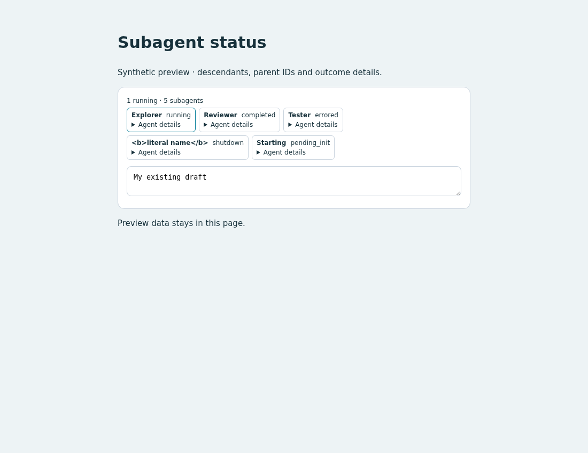

# Subagent status

## Behavior

Display descendant agents above the draft, with nickname, status and expandable
identity/outcome details. A running reviewer becomes `completed` when its result
arrives; an errored agent exposes the error text. The parent ID identifies nested
descendants. The header counts running agents and all retained descendants.

The panel reads a fresh inventory every two seconds after the prior request.
Switching conversations clears the old inventory immediately.
The whole panel stays hidden during initial loading, without a selected session
or when the inventory is empty. Polling continues while hidden, so new agents
appear automatically. Request failures display an error until polling recovers.

## Source

- [custom.js](source/custom.js): inventory polling, status rendering and lifecycle.
- [custom.css](source/custom.css): scoped wrapping rows and expandable details.
- [preview.html](preview.html): standalone synthetic preview.
- [fixture.mjs](source/fixture.mjs) and [verify.mjs](source/verify.mjs): data and
  browser checks used only by the preview.

## Integration

Read the installed `WORKSPACE_API.md`. The example uses
`GET api/sessions/{id}/agents` through `host.request`, with
`getActiveSessionId()` and `onSessionChanged()`. Status values are strings such
as `running`, `pending_init` and `shutdown`, or objects containing `completed`
or `errored`. The panel inserts into the built-in `.composer`.

Adapt the JS into the user's frontend and include its scoped CSS. An existing
`mount(host)` should contain the combined initialization rather than introducing
another export with the same name. Combine repeated session/request logic in
the final source when useful. Only `custom.js` and `custom.css` are needed;
the preview files are independent fixtures.

Retain the returned cleanup function if this panel can be removed. It aborts
requests, stops polling and removes listeners and DOM. Page-cache restoration
restarts polling. To undo, remove this setup and CSS or restore the user's
pre-edit backup. Refresh applies the resulting frontend.

Run from the repository root:

```bash
python3 -m http.server 8765 --bind 127.0.0.1 --directory packages/pycodex-ws/workspace_server/optional_features/subagent-status
```

Open `http://127.0.0.1:8765/preview.html?verify` and wait for PASS or FAIL.
The preview uses synthetic data. Stop the server with Ctrl-C.

## Validation

Chromium checks passed for the supplied preview:

| Scenario | Observed result |
| --- | --- |
| Nested, running, completed, errored, shutdown and pending agents | Parent IDs, count and outcome details displayed |
| Nickname containing HTML-like text | Rendered literally, without creating markup |
| Empty selection, loading and empty inventory | Entire panel hidden without occupying space |
| Polling from populated to empty and back | Entire panel hides and reappears automatically |
| Late response after switching | Old response ignored |
| Request failure followed by an empty successful result | Error displayed, then panel hidden |
| Page hide/cache restore, disposal and remount | Requests aborted, polling resumed and listeners removed |
| Desktop, 390px mobile and refresh | No horizontal overflow; existing draft retained |

Reproduce these checks with `preview.html?verify`.
[Desktop](preview.png) and [mobile](preview-mobile.png) screenshots are synthetic.
This template did not spawn live subagents or attach to a child stream.

## Preview



## Limitations

Polling can miss short intermediate states. This is a flattened descendant
inventory, not a complete execution archive or graphical tree. Detailed rows
are rebuilt when inventory content changes. It does not send input to agents,
resume them or enable interactive child requests. A full HTML replacement must
supply the insertion location and initialization.
